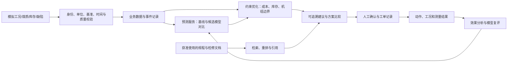

# 电厂数智化：前沿主方案与国产备用设计

日期：2026-10-14。面向未来求职、内部招聘和技术面试。任务 PP-100。

本文交付的是技术设计和学习路线；新增的知识助手、时序基础模型、联合优化与国产环境均未在本项目实现或验收。已实现能力依据固定代码与历史发布记录单独列出。口述与追问见 [面试讲解卡](INTERVIEW-CARDS-20261014.md)。

## 1. 建议选择的路线

建议沿“可靠业务闭环 → 有证据的智能辅助 → 有约束的联合决策”提升项目。这样既有现成代码可演示，又能回答前沿架构和国产替代问题。

| 路线 | 收获 | 代价与判断 |
|---|---|---|
| 深化现有可靠性 | 离线、并发、恢复、数据质量可直接讲代码 | 是最扎实的基础；单独讲时算法深度有限 |
| 在现有流程上增加可追溯智能辅助（推荐） | 规程检索、模型评估、约束优化形成完整故事 | 每项都要有评估和失败路径；可逐个交付 |
| 先建设三维大屏或统一更换技术栈 | 展示直观，能说明部署选型 | 业务价值和兼容成本难证明，暂不作为主线 |

核心展示场景选一台模拟燃煤机组：煤质与库存进入配煤比较，能效模块评估候选，规程助手解释依据，人工确认后记录执行与效果。设备点检作为独立的可靠性案例。燃气线保留为岗位相关的扩展，不在十分钟内展开全部仓库。

## 2. 现在已经有什么

本轮初始中央快照为 `1cda70cb9d12cf8cdb90cf84f0823a516b5ea062`。以下为本轮代码阅读与远端状态核对，历史测试未复跑。

| 主题 | 已有证据及适合讲的内容 | 表述边界 |
|---|---|---|
| 设备点检 | [重传测试](https://github.com/nizuowanzhenbang/equipment-inspection/blob/8047049bb3158959172edc5a7148dd5f35be4217/backend/tests/test_record_replay.py)、[事务锁](https://github.com/nizuowanzhenbang/equipment-inspection/blob/8047049bb3158959172edc5a7148dd5f35be4217/backend/app/utils/transactions.py)：相同任务测点重传返回原记录，冲突409，数据库约束防重复，锁后刷新旧对象 | 当前原型约定一个任务测点一条记录；不能不加新身份就扩展成同测点多次采样 |
| 库存与盘点 | [库存API](https://github.com/nizuowanzhenbang/equipment-inspection/blob/8047049bb3158959172edc5a7148dd5f35be4217/backend/app/api/spare_parts.py)、[历史证据](RELEASE-STOCKTAKE-20261004.md)：盘点需携带版本，库存变化后拒绝过时覆盖 | 历史验证有SQLite和指定PostgreSQL范围，不外推为任意数据库兼容 |
| 煤质质量 | [发布记录](../progress/evidence/2026-10-11-coal-quality-contract.md)，固定交付 `26bdbef9360e7b2ea2f037114adbf63ffdabb947`：热值单位、ar/ad/d基准、缺项、零值及非有限值保护 | kcal/kg与MJ/kg换算不等于ar/ad/d基准转换；缺少水分等条件时不能猜测 |
| 能效模型 | [算法源码](https://github.com/nizuowanzhenbang/coal-unit-efficiency/blob/39180dc6eed80b5d8392641e03f72f3c60fe6ae3/backend/app/algorithms/combustion_optimizer.py)、[输入证据](https://github.com/nizuowanzhenbang/coal-unit-efficiency/blob/39180dc6eed80b5d8392641e03f72f3c60fe6ae3/backend/app/services/optimization_evidence.py)：按时间留出、比较均值基线、越界降级、保存输入和数据摘要 | 氧量由负荷经验公式确定；线性回归用于估算收益。confidence是改善程度派生分数，未经概率校准 |
| 跨系统事件 | [设备PR #15](https://github.com/nizuowanzhenbang/equipment-inspection/pull/15) 与 [安全PR #4](https://github.com/nizuowanzhenbang/plant-safety/pull/4)：发送Outbox、接收收据及内容冲突保护 | 本轮核对均open、未合并；可讲候选设计和已有验证记录，不能讲成main已交付 |

本轮读取业务默认分支HEAD：设备 `8047049bb3158959172edc5a7148dd5f35be4217`，煤质 `96b68dece23f93de99a5b43e9144c03bfa985d1c`，能效 `39180dc6eed80b5d8392641e03f72f3c60fe6ae3`。HEAD与历史发布固定提交用途不同，不因文档提交更新而重新声称全套测试通过。

## 3. 一套能讲清的前沿架构

以下全部是待实现设计，图中的能力不代表当前平台已打通。

### 3.1 数据语义：先让各模块说同一种话

延续 PP-050，先统一 `plant_id / unit_id / equipment_id / coal_batch_id`，保留来源系统与来源主键，不按显示名称关联。观察值至少包含事件时间、接收时间、数值、单位、煤质基准、质量标记及来源版本。历史错误通过带版本的更正记录修复，避免静默改变旧建议的依据。

例如 `Qnet,ar=18 MJ/kg` 必须同时保存指标、ar基准和单位。缺失值、真实零值、无效值分开表示。模拟采集先用文件/API回放；现场若要接SIS、历史库或网关，需另做接口和隔离设计，现有项目未证明已接入。

跨系统业务事件沿现有Outbox候选继续：本地业务与待发消息同事务，接收端自然键与收据同事务。同身份同内容返回原结果，变更内容返回冲突；重试不更新原事件快照。传输可以重复，业务副作用依赖接收端防重；不承诺跨库恰好一次。消息中间件并非当前规模的先决条件。

### 3.2 规程知识助手：带引用的RAG与受限工具调用

场景：点检发现轴承温度偏高，助手定位适用版本的检修规程，展示条款、历史相似缺陷与核查步骤，生成供人复核的说明草稿。

流程：按文档章节切块 → 保留设备范围、版本、生效日期和权限 → 关键词与向量混合召回 → 重排 → 生成引用答案。权限过滤覆盖召回和返回；查不到依据则明确证据不足。文档中的指令当作资料内容处理，不能改变工具权限。先只开放查询工具；建工单仍走现有身份、校验、人工确认和审计。

主方案选本地可部署的Qwen系列生成模型，配Qwen3 Embedding/Reranker；具体生成模型规模按机器资源和评估确定。Embedding将文本编码供初筛，Reranker对问题与候选片段成对打分，两步解决效率和精度的取舍。[Qwen官方技术说明](https://qwenlm.github.io/blog/qwen3-embedding/) 提供了这两类模型及其结构信息；本项目尚未接入。

建议冻结一套100题模拟评估集，覆盖可回答、无依据、版本冲突、数值换算和越权问题，分开发集与留出集。报告Recall@k、引用是否支持结论、拒答是否正确、权限泄露和端到端延迟。生成答案中有引用编号，不代表引用必然正确。

### 3.3 时序基础模型：用对照实验判断值不值得接

场景先限定为模拟工况的短期趋势预测，例如每分钟记录预测未来15分钟排烟温度；这不等同于预测设备故障或推断调参效果。

前沿候选为TimesFM-3。Google Research于2026-08-31介绍其原生多变量预测、历史及已知未来协变量、分位数输出。原理可概括为将序列分块，在时间与变量维度交替建模，再预测未来窗口。[官方介绍](https://www.research.google/blog/timesfm-3-a-zero-shot-foundation-model-for-multivariate-forecasting/)

实验必须比较持久性预测、现有简单回归和基础模型，按时间滚动回测；标准化与特征处理只拟合训练窗。使用当时已知的计划负荷，不能把事后实际负荷或未来化验结果泄露给模型。报告MAE、相对基线改善、分位数区间覆盖和宽度、不同负荷段表现，以及推理延迟与资源消耗。未优于基线就保留简单模型。

若转向设备故障预测，需要另定义故障事件、提前量、标签、停机/检修干扰和样本截尾，评估误报次数、漏报及预警提前量；风险评分经sigmoid变换也不能自动成为可信故障概率。

### 3.4 机理与数据结合的约束优化

预测回答“可能怎样变化”，优化回答“在什么约束下选择哪种方案”。时序相关性不足以证明改变氧量的因果收益。现有氧量经验规则可作对照，下一步先做离线配煤求解，再逐步研究经校准的燃烧响应模型。

第一版仅选一台模拟机组、两到三个煤批次，定义配比、需求总量、库存、价格和同基准煤质。先用线性约束表示可解释的热值/硫分/灰分边界；灰熔融性、结渣、磨煤机与燃烧稳定性不能简单按加权平均担保，需要另行建模或明确限制适用范围。NOx和烟囱排放不能直接由煤硫分推定。

讲解算例（纯合成数据，非生产配煤建议）：A煤900元/吨、20 MJ/kg、硫1.2%；B煤500元/吨、15 MJ/kg、硫0.5%。为便于手算，两煤热值和硫分均假定已经取得收到基ar口径；不能将当前系统的干基硫分直接按收到基煤量混合。100吨需求，热值至少18 MJ/kg，硫不超过1.0%，库存充足。

令A煤质量占比为x：`Q=15+5x`，`S=0.5+0.7x`，`成本=500+400x`。约束给出 `0.6≤x≤5/7`，最低吨成本方案为A60吨+B40吨：740元/吨、18 MJ/kg、硫0.92%。折算燃料单位热量成本约41.11元/GJ；纯A为45元/GJ。两方案热值不同，不能直接将吨价降幅当作发电成本降幅。若A仅有50吨，当前需求与约束无可行解，应返回原因供人调整需求或补煤。

演示时同时展示输入、约束余量、求解状态、目标值和模型版本。主方案可用SCIP；国产备用选COPT。[SCIP官方资料](https://scipopt.org/) 与 [COPT官方文档](https://copt.shanshu.ai/copt-document) 用于核查求解器能力。先限定共同支持的问题类型；超时、有可行解但未证最优、不可行要分别处理。求解成功仍需独立重新计算约束残差。

更深入时可讲机理约束代理模型与MPC的思路，但需补动态模型、可调变量、运行包络和验证，当前不宣称已有数字孪生或自动闭环控制。

## 4. 国产备用方案：按能力替换并验证

前沿技术和国产技术可以重叠；主方案也可以选国产模型。这里的“备用”是部署与供应链适配设计，还没有可运行的国产备机。模型国产来源、国产硬件运行、全栈适配和信创认证是不同层次，不能互相代替。

| 层次 | 主方案候选 | 国产备用候选 | 兼容风险与切换验收 |
|---|---|---|---|
| 应用运行环境 | 保持FastAPI/React，常规Linux/x86 | openEuler＋鲲鹏等ARM服务器 | 核对Python/Node版本、原生库和镜像架构；跑业务、构建、迁移与恢复检查；无需为国产化先重写Java |
| 事务数据库 | 现有PostgreSQL | openGauss＋适配驱动/方言 | 验证SQLAlchemy2、枚举/JSON/序列、时区、锁、唯一约束、隔离级别及Alembic；PostgreSQL历史绿灯不代表已兼容 |
| 未来时序存储 | 先评估现有PostgreSQL容量 | 数据量证明必要时评估TDengine | 与事务库分工，不用时序库替代工单事务；核对乱序、去重、时间精度、保留策略与恢复 |
| 采集与传输 | 模拟API/文件、现有HTTP事件 | 现场扩展可评估国产网关、Neuron/EMQX | 验证协议、质量码、断线补传和许可证；MQTT QoS不替代业务幂等 |
| 知识生成与检索 | Qwen＋Qwen3检索/重排；通用GPU推理服务 | 经支持矩阵确认的Qwen模型＋昇腾/MindIE；检索可先保留CPU实现 | 核对每种模型、算子、量化与上下文长度；不能认为一个兼容API即可搬迁全部生成/Embedding/Reranker |
| 时序预测 | TimesFM-3作为实验候选 | MindSpore实现的小型LSTM/TCN候选，另保留简单规则基线 | 属于重新训练和评估，不是权重格式转换；相同数据切分比较误差、区间质量和资源成本 |
| 优化求解 | SCIP适配器 | COPT适配器 | 同一数学模型、变量边界、状态映射、容差和目标单位；比较目标值与可行性，不强求多解情况下配比完全相同 |

国产候选的官方资料：[openEuler](https://www.openeuler.org/zh/)、[openGauss SQLAlchemy方言](https://github.com/opengauss-mirror/openGauss-sqlalchemy)、[TDengine备份恢复](https://docs.taosdata.com/operations-and-tooling/operations/backup/)、[Neuron/EMQX工业方案](https://www.emqx.com/zh/blog/mqtt-sparkplug-solution-for-industrial-iot-using-emqx-and-neuron)、[MindIE](https://www.hiascend.com/developer/software/mindie)、[MindSpore LSTM](https://www.mindspore.cn/docs/zh-CN/r2.0/api_python/nn/mindspore.nn.LSTM.html)。其中MindSpore链接为指定版本的API参考，不代表建议锁定该旧版本。采购或实施前按当时版本、授权、离线安装要求和软硬件支持矩阵重新核查。

### 备用如何真正切换

先划分三种情况：模型服务切换可经统一适配接口完成；数据库迁移是有校验和维护窗口的迁移项目；业务降级是暂停智能推荐并继续人工流程。三者不能混称“自动容灾”。

1. 冻结输入契约和评估集，保存模型、提示词、索引、驱动、镜像与许可证版本。模型替换若改变Embedding空间，重建索引或同时保留两套，禁止混用向量。
2. 主备在同一批模拟输入上影子运行，比较答案依据、数值单位、预测误差、求解可行性与延迟。文本不要求逐字相同，业务结论必须有依据。
3. 模拟主模型超时/不可用后切到已验证备用模型，记录实际provider/version与降级原因；无已验证模型时只显示原始数据、规则或人工流程，规则也要标明依据与适用范围。
4. 数据库先演练导出导入、校验行数/业务汇总/约束和恢复。正式切换需控制写入并同步最后增量；切后有新写入时，回滚必须处理反向增量，不能直接连回旧库。
5. 记录实际RTO/RPO和失败结果，再确定能承诺的恢复目标。本轮没有完成这些演练，不给出已达标数字。

## 5. 后续可验收的升级顺序

下表是建议工作包，不是本轮实现结果，也不覆盖原 PP-030/040/041 候选的待审交接。

| 顺序 | 对应任务/仓库 | 最小交付与验收 | 面试能增加的内容 |
|---|---|---|---|
| 0 | 原可靠联动候选 | 独立审查与固定CI后接收端先集成；核对丢回执重试仍只有一条隐患 | 从本地事务走向分布式可靠性 |
| 1 | PP-050，煤质/煤场/能效 | 一台机组、两煤批次共享身份与单位；同名不同实体不误关联；旧建议可重现 | 工业数据语义与数据治理 |
| 2 | PP-060，煤场/能效 | 先落上述两煤算例与不可行算例；约束、成本和库存可独立复核 | 从报表走向约束决策 |
| 3 | 知识助手独立工作包 | 授权模拟文档、引用答案、固定评估集、无依据/越权拒绝 | RAG、工具权限与评估 |
| 4 | PP-070与能效实验 | 预测任务单独定义；滚动回测与简单基线比较，收益和失败都留档 | 基础模型与工程选择依据 |
| 5 | 国产适配独立工作包 | 先数据库/CPU环境，再有硬件时验证昇腾；模型和求解器各演练一次替换 | 国产替代从名单变成验证方案 |
| 6 | PP-090 | 记录人工选择、实际动作、工况与测量结果；预测和测量收益分列 | 效果归因与持续反馈 |

建议第一轮面试准备只练三个已实现案例、一个配煤算例和一张国产替换表。遇到深入追问，沿输入、约束、失败、验证四条线展开；没做过的部分明确说设计与验证计划。
